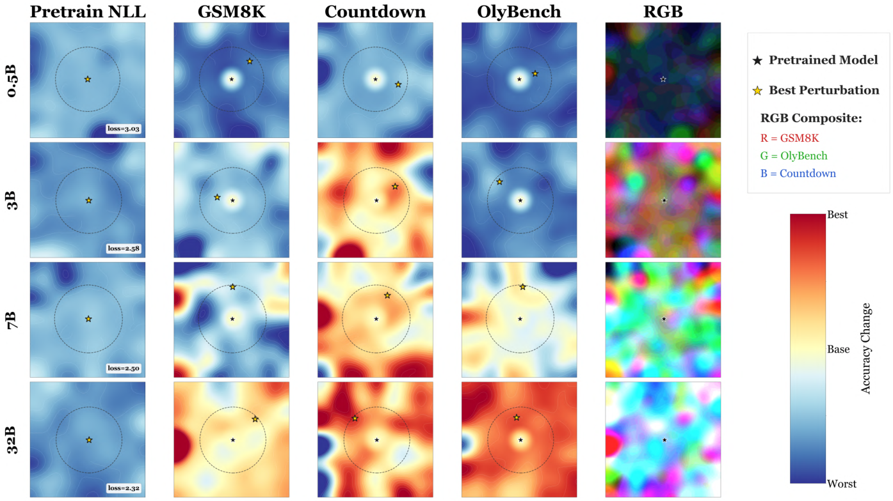

# Accuracy Landscapes



We perturb the pretrained Qwen2.5 models (from 0.5B to 32B) with 1000 random weight perturbations and project the perturbed models into 2D using random projection. Colors show relative accuracy change (acc − base)/base × 100 (blue: degraded, white: equivalent, red: improved.) Dashed circles indicate the mean perturbation distance and stars mark the best-performing perturbations. Larger models have warmer landscapes, with more high-performing neighborhoods. The last column shows an RGB visualization where GSM8K, Olympiad and Countdown accuracies are mapped to R,G,B channels; richer colors indicate more task experts.


## Run

From the RandOpt root (requires `matplotlib` in addition to `requirements.txt`):

```bash
bash analysis/landscape/run.sh
```
